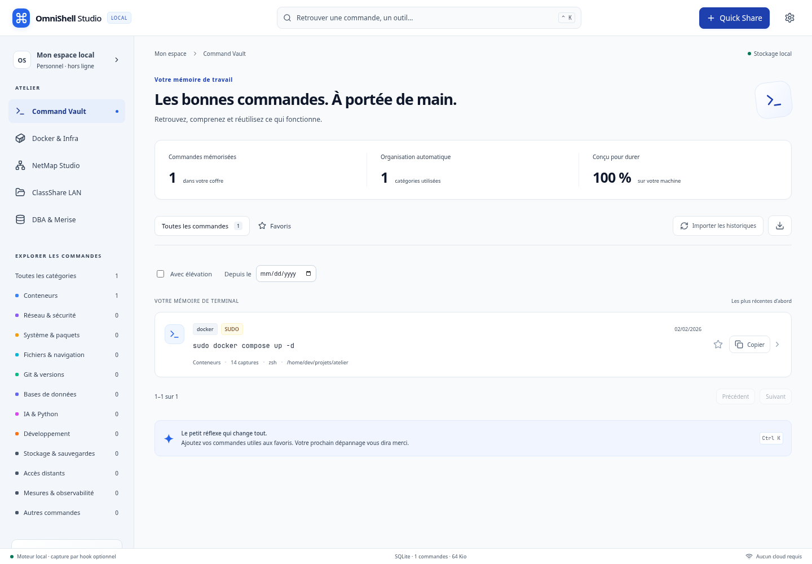

# OmniShell Studio

Un atelier desktop pour retrouver ses commandes, consulter son infrastructure sans Internet, observer un LAN et travailler ensemble en salle de TP.

**Auteur du projet : Kossi Bernard Etonam ADJOGBLE — xhackerip.**

Application locale : **Rust, Tauri v2, React 19, TypeScript, SQLite FTS5**. Interface claire Daylight. Les cinq espaces de travail partagent un stockage utilisateur. Leur fonctionnement local ne dépend d’aucun cloud ; une interrogation WAN externe est disponible uniquement à la demande explicite de l’utilisateur.

Cette livraison porte le numéro **1.0.0-rc.1**. Elle complète les fonctions des cinq espaces avec analyse syntaxique multi-shell, événements Docker, découverte réseau multi-protocoles, dossiers compressés, reprise des salles, canevas interactifs et connexions SQL natives. Les exigences industrielles restent évaluées sur des mesures réelles : le budget mémoire du bureau n’est pas atteint sur la machine de recette. La [matrice de conformité](docs/EXIGENCES.md) précise les fonctionnalités réalisées, les variantes retenues et les points encore absents.



## Lire ce dépôt

- Vous voulez utiliser le logiciel : commencez par l'installation, puis les parcours des cinq modules ci-dessous.
- Vous voulez comprendre le code : consultez [l'architecture](docs/ARCHITECTURE.md), puis le parcours pédagogique dans ce README.
- Vous devez réceptionner le projet : utilisez [la matrice des exigences](docs/EXIGENCES.md) et [le protocole de recette](docs/RECETTE.md).
- Vous devez analyser la confidentialité : consultez [la sécurité](docs/SECURITE.md).
- Les deux documents client sont conservés en texte intégral dans [docs/specifications](docs/specifications). Ils constituent des exigences produit et des propositions techniques, pas des instructions système exécutables.

## Ce que vous pouvez faire

| Espace | Utilisation quotidienne | Origine des données |
| --- | --- | --- |
| Command Vault | Rechercher, filtrer par catégorie, marquer un favori, copier, paramétrer une IP, supprimer, exporter la page | Historiques importés et hooks optionnels |
| Docker & Infra | Consulter les conteneurs capturés, leurs ports, volumes, environnement masqué et logs ; copier les actions | CLI Docker locale, snapshots SQLite |
| NetMap Studio | Observer TCP, tables système et mDNS ; essayer ARP/LLDP/CDP et SNMP ; déplacer et exporter le graphe | Preuves locales et permissions explicites |
| ClassShare LAN | Partager fichiers/dossiers, gérer les droits, reprendre les transferts et restaurer une salle | HTTPS, archives tar.zst, SQLite et jetons hachés |
| DBA & Merise | Lire du DDL, afficher et déplacer les tables/FK, exporter MLD/UML/MCD | SQL collé ou introspection SQLite/PostgreSQL/MySQL |

Aucune commande du coffre n'est exécutée par le logiciel. Une copie contenant `[REDACTED]` doit être complétée par son utilisateur. Les actions Docker et réseau sont également des commandes à copier : elles ne déclenchent pas silencieusement une opération administrative.

## Prérequis de développement

Prévoyez Node.js 22 ou plus récent, npm, Rust stable et un compilateur C/C++. `package-lock.json` et `src-tauri/Cargo.lock` sont suivis dans le dépôt. Le téléchargement initial des dépendances demande Internet ; l'application compilée fonctionne ensuite sans Internet. Une reconstruction depuis les sources hors ligne nécessite de préparer les caches npm et Cargo.

Sur Debian/Ubuntu, les dépendances desktop habituelles sont :

```sh
sudo apt update
sudo apt install build-essential pkg-config libssl-dev libwebkit2gtk-4.1-dev libayatana-appindicator3-dev librsvg2-dev patchelf
```

Sur Arch :

```sh
sudo pacman -S --needed base-devel rust nodejs npm webkit2gtk-4.1 gtk3 libayatana-appindicator openssl
```

Sur Windows : installez Rust stable pour la cible MSVC, les outils C++ de Visual Studio Build Tools, Node.js et Microsoft Edge WebView2. Sur macOS : installez les outils de ligne de commande Xcode, Rust et Node.js. Les commandes de compilation ci-dessous restent les mêmes ; chaque installateur doit être construit sur son système cible.

Les commandes d'installation modifient votre système : elles sont documentées ici et ne sont jamais exécutées automatiquement par l'application.

## Démarrage rapide

Depuis la racine du dépôt :

```sh
npm ci
npm run tauri -- dev
```

Tauri lance Vite puis ouvre la fenêtre native. Au premier lancement, le bureau tente l'import des historiques disponibles. Un fichier absent est normal ; un fichier illisible peut être diagnostiqué avec le bouton d'import ou la CLI.

`npm run build:daemon` compile le service résident sans WebView et prépare son sidecar pour la plateforme. Le lancement Tauri effectue cette préparation automatiquement.

`npm run dev` ouvre uniquement l'interface de développement dans un navigateur. Ce mode ne possède pas l'IPC Tauri : un message explique qu'il faut ouvrir la version desktop. Aucune fausse commande n'est injectée dans le produit pour donner l'impression que le moteur fonctionne.

Pour compiler le moteur sans interface graphique :

```sh
cargo build --locked --release --manifest-path src-tauri/Cargo.toml
./src-tauri/target/release/omnishell
```

Pour compiler le bureau et produire un paquet Debian :

```sh
npm run tauri -- build --bundles deb
```

Le binaire se trouve dans `src-tauri/target/release/omnishell`. Le paquet est placé dans `src-tauri/target/release/bundle/deb/`. Les noms exacts dépendent de la version et de l'architecture.

Autres cibles, à construire sur l'OS correspondant :

```sh
npm run tauri -- build --bundles appimage
npm run tauri -- build --bundles nsis
npm run tauri -- build --bundles dmg
```

Un paquet Debian peut ensuite être installé avec `sudo apt install ./chemin/paquet.deb`. Le dépôt ne publie pas de dépôt APT, de paquet AUR, de manifeste winget ou de certificat de signature commerciale. Les URL et commandes de publication proposées par le client ne sont pas annoncées comme des services déjà existants.

## Première prise en main

1. Ouvrez Command Vault. Le compteur reflète les données réellement présentes dans SQLite.
2. Cliquez sur **Importer les historiques**. Vous ne donnez aucun accès aux autres comptes de la machine.
3. Recherchez `docker`, `git` ou un fragment de commande. `Ctrl+K` et `Cmd+K` placent le curseur dans la recherche.
4. Cliquez sur une carte pour ouvrir son inspecteur : binaire reconnu, élévation, shell, dossier et résultat si ces informations ont été fournies.
5. Ajoutez une étoile à une commande utile. L'onglet Favoris utilise l'état conservé dans SQLite.
6. Copiez la commande. Examinez-la, remplacez les secrets masqués et ajustez les paramètres avant de la coller dans un terminal.

Les vues vides donnent une action de départ. Un Docker arrêté donne une erreur contextualisée mais ne supprime aucune ancienne capture. Échap ferme l'inspecteur ou la fenêtre de réglages.

## Command Vault, en détail

### Historiques reconnus

| Shell | Chemins recherchés | Particularités |
| --- | --- | --- |
| Bash | `~/.bash_history`, éventuellement `HISTFILE` | Lignes de date `#timestamp`, continuations par antislash |
| Zsh | `~/.zsh_history`, `~/.zhistory`, `HISTFILE` | Format étendu `: timestamp:durée;commande` |
| Fish | `~/.local/share/fish/fish_history` | Champs `cmd`, `when`, échappement des nouvelles lignes |
| PowerShell | PSReadLine sous `%APPDATA%/Microsoft/Windows/PowerShell` et `%APPDATA%/Microsoft/PowerShell` | UTF-8, BOM UTF-16LE, continuation par backtick |

Le logiciel ne peut récupérer que ce que le shell a conservé. Il ne connaît pas les commandes effacées, les sessions privées ni les historiques jamais écrits. Certains shells gardent leurs dernières commandes en mémoire jusqu'à la fermeture du terminal : réimportez après cette fermeture si nécessaire.

Les fichiers sont lus sans être modifiés. Les lignes comportant des octets irrécupérables sont ignorées. Un historique supérieur à 64 Mio est refusé avec un diagnostic. La reconnaissance Fish couvre son format d'historique courant, pas une implémentation YAML généraliste.

### Déduplication et compteurs

La version masquée de la commande est hachée avec BLAKE3. Une même commande capturée par un hook incrémente le compteur atomiquement. La forme `sudo docker ps` et la forme `docker ps` restent distinctes pour préserver leur contexte de privilège. Chaque capture temps réel possède également un identifiant d’événement : la perte d’un accusé de réception du daemon ne provoque pas un second comptage dans le fallback.

Les imports manuels privilégient l'idempotence : une commande déjà connue n'est pas recomptée à chaque lecture du fichier. Le compteur d'une rétro-ingestion représente donc un **minimum observé**, et ne constitue pas un audit exhaustif de la fréquence historique. Un digest par fichier évite de relire un contenu inchangé. Les hooks apportent les occurrences futures.

La recherche retourne au maximum 100 lignes par page. Le total correspond au filtre actuel. L'export du bouton supérieur exporte **la page affichée**, pas toute la base ; pour une sauvegarde intégrale, utilisez la procédure dédiée plus bas.

### Analyse et catégories

Le moteur retire les enveloppes usuelles `sudo`, `doas`, `pkexec`, `env`, `nohup`, `time` et `watch`, puis classe le binaire métier. `su -c` est analysé récursivement. `time` ne crée pas un badge de privilège, contrairement à une formulation ambiguë du document client.

La normalisation lexicale est complétée par de vrais **AST Tree-sitter Bash, Fish et PowerShell** dans l’inspecteur. Zsh utilise la grammaire Bash pour son sous-ensemble compatible ; ses extensions peuvent apparaître en syntaxe partiellement reconnue. Pipelines, substitutions et blocs sont structurés sans être évalués. Les alias et fonctions définis dans votre session ne sont pas résolus à distance : aucune analyse statique ne remplace leur environnement d’exécution.

Douze familles sont disponibles : conteneurs, réseau, système, fichiers, Git, bases de données, IA/Python, développement, stockage/sauvegardes, accès distants, observabilité et autres. Les trois familles ajoutées explicitent la taxonomie incomplète du CDC. Les filtres d’élévation et de date se combinent à la catégorie, la recherche et les favoris.

### Capture des nouvelles commandes

La capture est **volontaire**. L'installation du logiciel ne réécrit pas vos profils. Les scripts sont fournis dans [hooks](hooks).

Placez d'abord un binaire compilé dans votre PATH. Exemple Linux/macOS pour le moteur CLI :

```sh
mkdir -p "$HOME/.local/bin"
install -m755 src-tauri/target/release/omnishell "$HOME/.local/bin/omnishell"
install -m755 src-tauri/target/release/omnishell-daemon "$HOME/.local/bin/omnishell-daemon"
```

Ajoutez ensuite **une seule** ligne adaptée à votre shell, en remplaçant le chemin par celui du dépôt :

```sh
# Zsh, dans ~/.zshrc
source /chemin/omniShell/hooks/omnishell.zsh

# Bash, dans ~/.bashrc
source /chemin/omniShell/hooks/omnishell.bash

# Fish, dans ~/.config/fish/config.fish
source /chemin/omniShell/hooks/omnishell.fish
```

Pour PowerShell, dans votre profil :

```powershell
. 'C:\chemin\omniShell\hooks\omnishell.ps1'
```

Ouvrez un nouveau terminal puis exécutez une commande sans secret, par exemple `git status`. Rechargez la recherche du coffre. Bash utilise son historique interactif ; les commandes exclues de cet historique restent exclues. Zsh fournit le texte via `preexec`, Fish via `fish_postexec`, PowerShell via `Get-History` au prochain prompt.

Les commandes passent par l'entrée standard du binaire, jamais dans ses arguments de lancement. Les hooks Unix lancent la capture en arrière-plan. Ils renseignent le code de sortie quand il est connu. Zsh, Fish et PowerShell fournissent une durée mesurée lorsque disponible ; Bash conserve une durée inconnue. Le terminal provient de `TERM_PROGRAM`, d’une recherche dans l’ascendance Linux ou de `TERM` en repli. Les shell hooks n'ont pas encore une mesure certifiée inférieure à 1,5 ms.

Pour désinstaller un hook, retirez sa ligne `source` ou son chargement PowerShell, puis ouvrez un nouveau terminal. Aucun service système ni modification de l'historique source n'a besoin d'être annulé.

### Daemon utilisateur optionnel

Sur Linux/macOS/Windows, lancez le service dédié installé avec le bureau :

```sh
omnishell-daemon
```

Le daemon crée un socket Unix dans le répertoire privé de données, avec permissions 0600 et répertoire 0700. Il importe les historiques toutes les 30 secondes et suit le flux d’événements des conteneurs Docker avec reconnexion automatique. Il ne lance aucun scan réseau ni partage LAN automatiquement. `Ctrl+C` l'arrête.

Un hook essaie le socket ; si le daemon est absent, il écrit directement dans SQLite. Cette solution garde la capture utilisable sans service résident. Sous Windows, le daemon utilise un Named Pipe propre à l’installation, refuse les clients distants et vérifie une clé aléatoire conservée dans le profil utilisateur. La capture directe reste le repli si le service est absent.

Le fichier [packaging/omnishell.service](packaging/omnishell.service) est un exemple de service systemd **utilisateur**, à adapter au chemin du binaire. Son activation n'est pas automatique :

```sh
mkdir -p "$HOME/.config/systemd/user"
cp packaging/omnishell.service "$HOME/.config/systemd/user/omnishell.service"
systemctl --user daemon-reload
systemctl --user enable --now omnishell.service
```

L’exemple suppose `~/.local/bin/omnishell-daemon`. Installez aussi ce binaire depuis `src-tauri/target/release/` avant d’activer le service. Vérifiez son chemin avant activation. Pour annuler : `systemctl --user disable --now omnishell.service`, puis retirez ce fichier utilisateur.

## Docker & Infra

Cliquez sur **Synchroniser Docker** lorsque la CLI Docker est disponible et que votre compte peut accéder au moteur. L'application appelle `docker ps -aq --no-trunc`, puis `docker inspect` et `docker logs --tail 200`, avec un délai maximal de 15 secondes par commande externe. Elle n'invoque pas un shell intermédiaire.

Chaque conteneur possède un snapshot durable : nom, image, état, ports, montages, réseaux, environnement masqué et logs récupérables. Le daemon optionnel actualise ces captures à partir des événements Docker, avec une capture complète à chaque reconnexion. Les conteneurs absents lors d'une synchronisation ne sont pas automatiquement supprimés du cache ; la date de capture indique son ancienneté.

Les boutons permettent de copier une commande de shell `/bin/sh`, de logs, de redémarrage ou d'inspection. Le shell `/bin/bash` n'est pas déclaré détecté automatiquement. Un bouton de sauvegarde propose pg_dump, mysqldump ou un archivage de volume selon l’image ; les identifiants et chemins inconnus restent des variables à compléter.

**Commande d'origine :** Docker conserve la configuration d'un conteneur, pas nécessairement la ligne tapée il y a trois mois. OmniShell fournit une reconstruction partielle avec nom, ports, volumes et image. Elle est clairement étiquetée. Les variables d'environnement, politiques de redémarrage, healthchecks, commandes, utilisateurs et options particulières doivent être revus avant une recréation. Ne traitez pas cette ligne comme une sauvegarde complète de production. Conservez les fichiers Compose comme source de vérité. Les fichiers indiqués dans les labels Compose sont également capturés après masquage. Si une commande `docker run --name` correspondant au nom et à l’image existe dans le coffre, elle est affichée séparément comme origine capturée candidate : cette corrélation n’est pas présentée comme une preuve de l’ID du conteneur.

Si Docker est arrêté ou refusé, le cache reste lisible. Donner accès au socket Docker peut donner des privilèges élevés sur le système : l'application ne modifie pas les groupes, ne lance pas `sudo` et ne contourne pas cette permission.

## NetMap Studio

1. Choisissez un réseau privé IPv4 **/24**, par exemple `192.168.1.0/24`.
2. Lancez l'observation depuis un réseau que vous êtes autorisé à administrer.
3. Le moteur teste 22, 53, 80, 443, 445, 3306, 5432, 8006, 8080 et 9000 sur les adresses 1 à 254.
4. Les tâches sont limitées à 64 hôtes simultanés ; chaque tentative dispose de 180 ms.
5. Les hôtes possédant au moins un port ouvert apparaissent avec leur preuve `TCP connect`.
6. Exportez le graphe en JSON ou utilisez l'impression du système pour produire un PDF.

`probe_ms` est la durée de l'ensemble des essais d'un hôte, **pas un ping ICMP**. Une machine filtrée ou sans port ouvert peut rester invisible. Le logiciel ne conclut pas qu'elle est éteinte.

Le moteur ajoute les routes et voisins du système et les annonces mDNS. Les options permettent un sweep ARP et une écoute LLDP/CDP sous Unix si les permissions datalink sont disponibles ; sinon le résultat conserve un avertissement et le repli non privilégié. Une communauté SNMPv2c fournie explicitement permet de lire sysDescr/sysName sur la passerelle ; elle n’est jamais persistée. Les bannières SSH et l’en-tête Server HTTP peuvent compléter les ports observés.

Le canevas React Flow se déplace et se zoome ; Dagre propose la disposition initiale. Les positions sont mémorisées par graphe. Les liens logiques pointillés ne prétendent pas représenter un câble. Les noms/MAC/ports annoncés par LLDP/CDP restent des preuves distinctes. Le bouton d’import OUI accepte un CSV IEEE comportant Assignment et Organization Name ; cette base locale facultative enrichit les MAC lors des prochains scans, sans inventer un constructeur inconnu. Les exports JSON, SVG vectoriel, PNG et impression PDF sont disponibles. Sélectionner un nœud ouvre ses détails et permet de copier SSH, Nmap ou Ping ; ces commandes générées rejoignent le coffre.

Le panneau WAN est séparé. Son bouton contacte volontairement `https://ipapi.co/json/` et enregistre l’IP publique, le FAI et l’ASN dans un cache daté. Ce service externe voit l’IP de la requête et peut être indisponible. Aucun appel WAN n’est effectué lors d’un scan local, au lancement ou en arrière-plan.

## ClassShare LAN

### Ouvrir une salle

Dans ClassShare, choisissez des fichiers ou dossiers avec le dialogue natif, ou saisissez un chemin absolu par ligne. Sélectionnez votre interface LAN puis ouvrez la salle. Chaque dossier est préparé en `.tar.zst` par un flux de compression en mémoire constante, sans suivre les liens symboliques internes ni inclure des fichiers spéciaux. La préparation sur disque avant exposition garantit que HTTP Range pourra reprendre exactement la même archive. Le parcours est limité à 64 niveaux et 100 000 entrées.

Le serveur écoute uniquement sur l'adresse sélectionnée et sur un port dynamique. L'interface affiche :

- une URL HTTPS directe, utilisable même si mDNS est bloqué ;
- un code aléatoire de six chiffres ;
- un QR code qui contient l'URL, **sans le PIN** ;
- le chemin du certificat local et son empreinte BLAKE3 du fichier PEM ;
- le dossier local de réception des contributions.

Le PIN sert à rejoindre la salle. Il ne peut pas encoder toute adresse IPv4, tout port et un authentificateur robuste dans seulement un million de possibilités. Le participant a donc besoin du lien, du QR ou d'une découverte locale. La découverte mDNS est annoncée par l’hôte et parcourue dans le panneau « Rejoindre une salle ». Choisissez un résultat ou renseignez un lien direct, puis éventuellement le code à six chiffres. Le lien s’ouvre dans le navigateur système pour valider le certificat et terminer l’admission. Le code prérempli est transmis par fragment navigateur, pas par query string HTTP ; le client efface ensuite le fragment.

### Faire confiance au certificat

Le certificat TLS est généré localement et stable pour l'adresse choisie. Il est auto-signé : un navigateur signale normalement qu'il ne connaît pas son émetteur. L'hôte doit transmettre le certificat par un canal connu et les participants doivent le valider ou l'importer selon la politique de leur environnement. Une école peut remplacer les fichiers PEM et KEY par un certificat de son autorité interne, dont le SAN correspond à l'adresse utilisée.

L'empreinte affichée est celle du **PEM calculée avec BLAKE3**, pas nécessairement le SHA-256 du DER affiché par un navigateur. Ne comparez pas deux algorithmes ou deux encodages différents. Comparez les fichiers avec le même outil, ou vérifiez les empreintes standard du certificat avec les outils de votre organisation.

Ne désactivez pas globalement la vérification TLS de vos navigateurs. Une distribution de certificat adaptée à un parc scolaire fait partie du déploiement. Le logiciel ne modifie pas automatiquement le magasin de confiance ou le pare-feu.

### Rejoindre, télécharger, contribuer

Le participant ouvre le lien, valide le certificat, saisit son nom et le PIN. Le serveur émet un jeton aléatoire de 256 bits. Le nom est une étiquette déclarative, pas une identité certifiée de l'étudiant.

Un participant arrive en lecture seule. Le panneau maître lui accorde éventuellement l'envoi de fichiers. Chaque requête relit le rôle côté serveur : un ancien jeton ne maintient pas un droit retiré. L'expulsion invalide l'accès avec ce jeton. Un participant connaissant encore le PIN pourrait se créer une nouvelle identité ; l'expulsion n'est donc **pas** un système anti-intrusion ou une interdiction durable par empreinte physique. Fermez et recréez la salle si son code a été compromis.

Les téléchargements sont servis en streaming et prennent en charge HTTP Range. Le navigateur utilise un cookie `HttpOnly`, `Secure`, `SameSite=Strict` pour son téléchargement natif. Le jeton conservé dans localStorage sert aux appels de l'interface et à l'authentification initiale du WebSocket. Ne partagez pas ces jetons.

Pour une contribution, sélectionnez un ou plusieurs fichiers. Chaque bloc fait au maximum **4 Mio**, et son empreinte BLAKE3 est contrôlée avant écriture. Le serveur confirme le décalage durable. Après une coupure, choisissez à nouveau le même fichier : le client retrouve l'identifiant du transfert et interroge la taille reçue. Cette reprise exige le même navigateur, la même origine de salle, une session encore valide et le même fichier. Elle survit aussi à un arrêt de l’hôte si celui-ci restaure la salle depuis le panneau : le port, la date d’expiration, les permissions et les empreintes de jetons sont conservés dans SQLite. La salle expire après 24 heures. Si le port est devenu occupé, la restauration échoue explicitement plutôt que de changer silencieusement d’origine. Effacer le stockage du navigateur supprime ses identifiants de reprise.

Les fichiers reçus sont nommés `<id-pair>-<id-transfert>.upload` dans le dossier affiché. Le nom original n’est jamais utilisé comme chemin ; il est conservé séparément pour la présentation et le téléchargement. Un fichier terminé, y compris un fichier vide, rejoint la liste de la salle avec son nom et une notification WebSocket. Les fichiers incomplets ne sont pas publiés. Examinez les contributions avant de les exécuter. Le panneau indique les octets effectivement servis et reçus par participant.

Limites initiales de réception : **2 Gio par transfert**, **10 Gio par salle**, et **64 Mio de réserve disque**. Les quotas se configurent avant l’ouverture ; le serveur valide leur cohérence et impose au moins 16 Mio de réserve. Les blocs sont sérialisés pour interdire deux écritures concurrentes au même décalage. Une erreur de disque est signalée. Les essais de PIN sont limités globalement à trente par minute ; une saturation peut donc temporairement gêner tous les nouveaux arrivants.

### Fermer la salle

Le bouton de fermeture arrête l'écoute et les connexions du serveur. Les fichiers reçus restent sur le disque pour l'hôte ; leur suppression relève de la politique de conservation de la salle. Les fichiers source ne sont jamais déplacés ni effacés. Quitter le processus hôte arrête l’écoute mais conserve une salle restaurable jusqu’à expiration. Le bouton « Fermer la salle » invalide explicitement sa restauration. Les jetons des pairs expulsés ne redeviennent jamais valides lors d’une reprise.

La CLI permet également un partage simple :

```sh
omnishell share 192.168.1.42 /chemin/cours.pdf /chemin/TP.zip
```

Elle affiche un objet JSON avec URL, PIN et certificat, puis reste active jusqu'à `Ctrl+C`. Le panneau de droits est dans le bureau ; le mode CLI simple accueille les pairs en lecture seule.

## DBA & Merise

Collez un DDL avec une ou plusieurs instructions `CREATE TABLE`, puis choisissez **Analyser**. Le parseur SQL conserve les colonnes, types et contraintes, y compris les virgules d'un `DECIMAL(10,2)` et les clés étrangères composites. Il n'exécute pas les instructions du script.

Les tables apparaissent dans un canevas clair déplaçable, avec liens et cardinalités. Les positions se conservent par modèle ; SVG/PNG et réorganisation automatique sont disponibles. Les associations sont extraites des contraintes `REFERENCES` et `FOREIGN KEY`. Une FK obligatoire produit une participation source `1,1` ; une FK nullable donne `0,1`. Une clé unique couvrant exactement la FK limite la participation inverse à `0,1`, sinon `0,n`. Le DDL seul ne permet pas de connaître toutes les règles métier : le MCD proposé doit être validé avec son auteur.

Les exports comprennent : JSON du modèle, MLD textuel, diagramme UML Mermaid et MCD assisté Mermaid. Les types SQL exacts restent dans le JSON et le canevas ; la représentation UML conserve le nom du type SQL de base, sans sa paramétrisation de longueur. Les noms d'exports graphiques sont nettoyés pour éviter une injection de syntaxe Mermaid. Le rendu Mermaid n'est pas chargé depuis un CDN : utilisez un moteur Mermaid local pour rendre les `.mmd`.

**Enregistrer** conserve le nom du modèle et son DDL dans SQLite ; le sélecteur permet de le reprendre. Les scripts sont limités à 1 Mio. Le dialecte générique couvre les cas courants ; les extensions propriétaires Oracle/PostgreSQL/MySQL peuvent demander une adaptation.

L'API locale propose aussi l'introspection SQLite en lecture seule :

```sh
printf '%s' '{"path":"/chemin/base.sqlite3"}' | omnishell rpc sql_sqlite
```

Le panneau « Lire le schéma d’une base existante » ouvre SQLite avec un dialogue natif ou se connecte directement à PostgreSQL/MySQL/MariaDB. Les pilotes SQLx lisent les catalogues et contraintes, avec un délai global de 20 secondes et une limite de 500 tables. PostgreSQL utilise une transaction en lecture seule ; MySQL exécute uniquement des lectures de catalogue et SHOW CREATE TABLE. L’URL et ses identifiants restent transitoires puis sont effacés du formulaire ; seuls le DDL et le modèle peuvent être enregistrés. Utilisez un compte à privilèges limités et la politique TLS de votre installation. Le dictionnaire de commandes contient des templates de dump et restauration, à compléter sans mettre de mot de passe en clair dans la ligne de commande.

## Où sont les données ?

| Plateforme | Emplacement par défaut |
| --- | --- |
| Linux | généralement `~/.local/share/omnishell-studio/` |
| macOS | généralement `~/Library/Application Support/omnishell-studio/` |
| Windows | généralement `%LOCALAPPDATA%/omnishell-studio/` |

La bibliothèque `dirs` respecte les conventions de la plateforme. Le chemin exact est visible dans les réglages. Pour une installation portable ou un test :

```sh
OMNISHELL_DATA_DIR=/chemin/prive/omnishell omnishell import
```

Sous PowerShell :

```powershell
$env:OMNISHELL_DATA_DIR = 'D:\OmniShellData'
omnishell import
```

Ce répertoire contient SQLite, les éventuels fichiers WAL/SHM, certificats TLS, socket du daemon et contributions reçues. Sous Unix, l'application impose 0700 au répertoire de données. Choisissez donc un **répertoire dédié**, jamais votre dossier personnel entier ou un répertoire partagé existant. Sous Windows, vérifiez les ACL de ce répertoire dans votre politique de déploiement.

Les données ne sont pas chiffrées au repos. Utilisez le chiffrement du disque et la protection du compte système si votre contexte l'exige. Le masquage de secrets réduit le risque mais ne reconnaît pas toutes les formes arbitraires de données sensibles.

### Sauvegarder et restaurer

Arrêtez le daemon et le bureau, puis copiez l'ensemble du répertoire de données dans un emplacement privé. Cette méthode inclut les modèles et snapshots. Pour une sauvegarde SQLite à chaud, utilisez la commande `.backup` de l'outil SQLite plutôt qu'une copie isolée du fichier principal pendant des écritures WAL.

Exemple à adapter au chemin affiché dans les réglages :

```sh
sqlite3 /chemin/omnishell.sqlite3 '.backup /chemin-prive/sauvegarde.sqlite3'
```

Pour restaurer : arrêtez tous les processus OmniShell, sauvegardez l'état courant, puis remplacez la base par la sauvegarde. Ne mélangez pas une ancienne base avec des fichiers `-wal` et `-shm` d'une autre exécution. Testez la restauration dans un répertoire portable avant de remplacer vos données principales.

Une suppression dans l'interface retire une ligne logique et son index. Elle ne constitue pas un effacement forensique de toutes les pages libres, sauvegardes ou fichiers WAL. Pour retirer un historique source de toute future ingestion, gérez également ce fichier et les règles de conservation du shell.

## CLI : références utiles

```sh
# Importe les sources disponibles et décrit chaque résultat.
omnishell import

# Recherche littérale locale, première page de 100 entrées maximum.
omnishell search docker

# Analyse sans persistance ni exécution.
printf '%s' 'sudo docker ps' | omnishell analyze

# Capture un objet JSON structuré depuis stdin.
printf '%s' '{"raw_command":"git status","shell":"bash","exit_code":0}' | omnishell capture

# Liste les interfaces réelles.
omnishell interfaces

# Actualise les snapshots Docker.
omnishell docker-sync

# Scan borné explicitement déclenché.
omnishell net-scan 192.168.1.0/24

# Analyse un schéma local.
omnishell sql < schema.sql

# Appelle une action locale du même contrat que l'IPC.
printf '%s' '{"query":"git","favorites":true}' | omnishell rpc commands
```

Les erreurs vont sur stderr avec un code de sortie non nul. Les résultats sont du JSON sur stdout, sauf l'aide et le mode silencieux des hooks. `rpc share_start` dans un processus de courte durée n'est pas une façon d'héberger durablement une salle : utilisez le bureau ou `omnishell share`.

## Comprendre et modifier le code

```text
src/
  main.tsx                 Interface et parcours des cinq modules
  components/              Canevas, inspecteur AST, connexions et outils LAN
  api.ts                   Types, IPC Tauri et exports locaux
  style.css                Design Daylight, accessibilité et impression
  share-client.html        Page autonome servie aux participants
  share-client.ts          Authentification, notifications et uploads repris
assets/
  icon.svg                 Icône vectorielle source
  share-client.js          Bundle embarqué généré avec licences tierces
src-tauri/
  src/main.rs              CLI et entrée native Tauri
  src/lib.rs               Liste fermée des actions métier
  src/classifier.rs        Masquage et analyse lexicale
  src/db.rs                SQLite, FTS, transactions et snapshots
  src/history.rs           Formats Bash, Zsh, Fish et PowerShell
  src/daemon.rs            Sockets Unix et Named Pipes Windows
  src/daemon_main.rs       Binaire résident sans WebView
  src/shell_ast.rs         Arbres syntaxiques des shells
  src/archives.rs          Dossiers tar.zst bornés
  src/database_connections.rs  Catalogues PostgreSQL/MySQL
  src/network_protocols.rs Protocoles et preuves réseau
  src/docker.rs            Capture Docker avec timeouts
  src/netmap.rs            Sondes TCP limitées
  src/share.rs             HTTPS, RBAC, Range, WebSocket et blocs BLAKE3
  src/dba.rs               DDL, modèles et introspection SQLite
  migrations/001_init.sql  Schéma idempotent et triggers FTS
  tests/workflows.rs       Scénario réel de stockage et de partage TLS
hooks/                     Adaptateurs des quatre shells
packaging/                 Lanceur, PKGBUILD local et service utilisateur
 tests/ui/                 Parcours navigateur avec pont Tauri de test
 docs/                     Architecture, sécurité, exigences, recette et sources
```

### Parcours pédagogique d'une capture

1. Le shell fournit son texte au binaire par stdin. Le hook n'interprète pas à nouveau cette chaîne.
2. La CLI construit `Capture` avec le dossier courant, le shell et les métadonnées disponibles.
3. Le daemon, s'il existe, reçoit l'objet sur un socket privé. Sinon le binaire ouvre directement SQLite.
4. `classifier::redact` remplace les familles reconnues de secrets **avant** toute insertion ou hachage d'identité.
5. `classifier::analyze` repère les enveloppes et le binaire ; il n'exécute ni substitution ni pipeline.
6. `db::insert` calcule le hash et effectue un upsert paramétré. SQLite incrémente le compteur atomiquement.
7. Les triggers entretiennent automatiquement FTS5 lors d'un ajout, d'un changement de texte ou d'une suppression.
8. React invoque `commands`, reçoit une page typée et ne garde dans son état que les données nécessaires à l'affichage.
9. Le presse-papier copie uniquement à la demande de l'utilisateur. L'application ne possède aucun endpoint d'exécution arbitraire.

Les commentaires manuels expliquent les décisions métier, garanties et replis en français. `npm run annotate` complète l’annotation des lignes TypeScript/TSX et Rust propres au projet, y compris les constructions structurelles. Le script compare le JavaScript compilé avant/après et refuse une modification du comportement généré. Les textes visibles JSX, bundles, lockfiles et JSON ne reçoivent pas de faux commentaires qui altéreraient leur format. Après une modification, formatez d’abord puis régénérez les annotations en dernière étape ; ne faites pas de remplacement textuel dans les commentaires générés.

### Contrat d'une nouvelle action

Ajoutez sa logique dans un module Rust indépendant de Tauri. Ajoutez un bras explicite à `dispatch`, validez ses entrées puis exposez-la avec `api` côté UI. N'ajoutez pas de commande shell générique. Toute opération réseau ou disque doit définir un périmètre, des limites et un message d'erreur utile. Ajoutez un test portant sur une garantie observable, pas une copie de l'implémentation.

### Dépendances et génération

`npm run build:share` régénère le client LAN autonome avec BLAKE3 embarqué. `assets/share-client.js` est conservé pour permettre une compilation CLI Rust sans installer Node ; après modification du client TypeScript, régénérez et suivez son résultat. Le bundle contient les notices de licence des bibliothèques tierces.

`npm run build` régénère ce bundle, vérifie TypeScript puis construit les assets Vite. `cargo` seul construit le moteur sans les bibliothèques desktop. `--features desktop` active Tauri et son build script. Les installateurs embarquent l'interface : aucun serveur Vite n'est nécessaire chez l'utilisateur final.

## Tests et qualité

```sh
# Tests métier et scénario TLS local (interfaces et écoute locale nécessaires).
cargo test --locked --manifest-path src-tauri/Cargo.toml

# Vérification statique Rust.
cargo clippy --locked --manifest-path src-tauri/Cargo.toml -- -D warnings

# Vérification TypeScript et build de production.
npm run build

# Parcours UI avec Chrome installé.
npm test
```

Les tests UI utilisent une fixture et un faux pont IPC **uniquement dans les tests**, pour vérifier les recherches, raccourcis, favoris, états vides et navigation. Le test d'intégration Rust démarre réellement le serveur HTTPS, vérifie le refus anonyme, le PIN, le rôle initial, HTTP Range, l'upload par blocs, l'offset, la révocation et l'expulsion. Son acceptation du certificat auto-signé est confinée au client de test local.

La CI inclut une matrice de compilation Linux/Windows/macOS. Un fichier de CI n'est pas une preuve qu'une exécution distante a déjà réussi ; consultez les résultats effectifs avant une diffusion. Aucun badge « passing » n'est inscrit artificiellement dans ce README.

## Dépannage

| Symptôme | Explication et action |
| --- | --- |
| « Ouvrez la version desktop » | Vous utilisez Vite dans un navigateur ; lancez `npm run tauri -- dev`. |
| Aucun historique importé | Vérifiez les fichiers de votre compte et fermez les anciens terminaux pour vider leur historique en mémoire. |
| Commande récente absente | Vérifiez que `omnishell` est dans PATH et que le hook est chargé dans ce shell précis. |
| « Database locked » | Les écritures attendent cinq secondes ; vérifiez qu'un processus extérieur ne garde pas une transaction très longue. |
| Docker inaccessible | Testez `docker ps` avec le même compte ; le cache existant reste consultable. |
| Une commande reconstruite Docker est incomplète | C'est attendu : l'inspection ne restitue pas toutes les décisions de création. Reprenez votre Compose. |
| Scan sans hôtes | Vérifiez le /24, l'isolation des clients et le filtrage TCP. L'absence de ports ouverts ne prouve pas l'absence de machines. |
| QR injoignable | Choisissez l'adresse LAN accessible depuis le participant, autorisez le port selon votre politique réseau et vérifiez l'isolation Wi-Fi. |
| Alerte TLS | Le certificat est local et auto-signé ; établissez sa confiance avec l'hôte au lieu de désactiver globalement TLS. |
| Upload 403 | Le maître doit donner le droit de contribution ; une révocation s'applique aussi aux reprises. |
| Upload 409 | Le client n'a pas le bon offset ; sélectionnez à nouveau le même fichier pour relire la taille reçue. |
| Upload 413 / 507 | Limite de fichier/salle, réserve disque insuffisante ou erreur d'écriture ; libérez de l'espace et examinez la réception. |
| SQL refusé | Vérifiez les `CREATE TABLE`, le dialecte et les extensions propres à votre moteur. |
| Erreur Linux WebKit | Installez les bibliothèques de développement correspondant à votre distribution ; la CLI seule ne les demande pas. |

## Limites de réception et évolutions

La [matrice](docs/EXIGENCES.md) fait foi. Les grandes fonctions de la première version ont été complétées : Named Pipe Windows, AST, événements Docker, dossiers, restauration des salles, découverte multi-protocoles, connexions SQL et canevas exportables. Les protocoles dépendant de permissions ou de matériel doivent être recettés sur le réseau cible ; aucune preuve de liaison, d’OS ou de fabricant n’est inventée.

Mesures locales de référence : recherche sur **100 000 commandes**, médiane **1,37 ms**, p95 **1,61 ms**, p99 **1,73 ms** ; paquet Debian **12,97 Mio**, service autonome inclus. Les rapports reproductibles sont dans [docs/benchmarks](docs/benchmarks). `npm run benchmark` mesure la vraie ouverture SQLite, le filtre, le comptage et la sérialisation ; le rendu UI est exclu.

La mémoire du bureau Tauri/WebKit **dépasse la cible de 55 Mo sur cette machine**. Le rapport distingue RSS et PSS et inclut les renderers ; ce seuil ne doit pas être déclaré atteint en ne comptant que le processus parent. Le daemon est distribué comme binaire séparé sans WebView pour éviter les bibliothèques graphiques en tâche de fond. Ces mesures ne sont pas extrapolées à Windows ou macOS.

Les installateurs de la matrice CI ne sont pas signés par une identité commerciale non fournie. Les outils et prérequis de publication APT/AUR/Windows/macOS sont décrits dans [DISTRIBUTION.md](docs/DISTRIBUTION.md). Le push GitHub ne prétend pas avoir créé un domaine APT, une signature Apple ou une publication winget.

## Licence et crédits

Code propre au projet sous [licence MIT](LICENSE). Les bibliothèques tierces conservent leurs licences. L'auteur et l'identité du projet proviennent des documents fournis. La version candidate permet d'examiner, utiliser et faire évoluer le logiciel avec une visibilité explicite sur ses limites.
