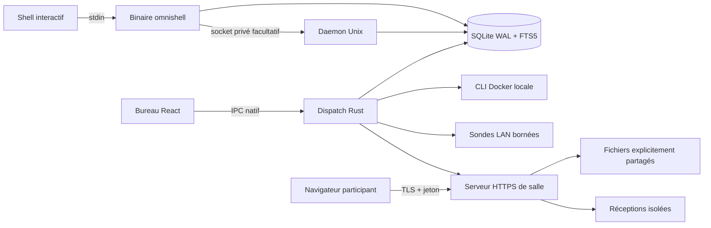

# Architecture de l'atelier

## Deux frontières de confiance

Le bureau Tauri accède aux données privées par IPC natif. Le serveur ClassShare expose uniquement ses fichiers autorisés et les routes des participants. Il n'existe aucun serveur HTTP donnant accès à l'historique, aux modèles ou aux opérations administratives du bureau.

`main.rs` héberge les deux entrées CLI et Tauri. `lib.rs` expose une liste fermée d'actions. Les modules métier ignorent le framework UI : leurs fonctions peuvent être invoquées et testées directement. Les erreurs traversent les tâches avec un type `Result` commun, puis deviennent un message d'interface ou une sortie CLI non nulle.

## Cycle de vie

Aucun scan actif et aucun partage ne sont lancés au démarrage. Le bureau tente un import de ses historiques. Le daemon est un processus utilisateur séparé et volontaire. Il prend un verrou exclusif avant de gérer son socket et actualise les historiques/Docker toutes les trente secondes.

Une salle appartient à une poignée `Host`. Son remplacement ferme l'ancienne salle. La destruction de la poignée arrête le serveur et l'annonce mDNS. Les captures historiques ne sont pas supprimées à la fermeture de leurs producteurs.

L'état des rôles LAN est en mémoire et la reprise navigateur suppose la même salle active. La persistance après un arrêt de l'hôte nécessiterait une gestion de session durable, une politique d'expiration et une nouvelle recette ; elle n'est pas simulée avec un simple fichier de jetons.

## Schéma local

- `commands` contient uniquement des commandes masquées et leurs dernières métadonnées connues. Le hash unique alimente un upsert atomique du compteur.
- `command_fts` est un index FTS5 externe relié par trois triggers aux insertions, mises à jour de texte et suppressions.
- `imports` associe un chemin de source à un digest de contenu pour éviter un travail répété.
- `snapshots` conserve un document JSON par paire `(kind, key)` ; l'horodatage rend son ancienneté explicite.
- `models` conserve le DDL et la date de sauvegarde d'un modèle nommé.

La migration est idempotente. WAL et le délai d'attente de cinq secondes s'appliquent sur chaque ouverture. Les requêtes utilisateur sont paramétrées ; les noms de colonnes et les clauses SQL dynamiques proviennent du code, jamais de la saisie utilisateur.

La recherche traite sa saisie comme du texte littéral : échappement des caractères LIKE, guillemets FTS. Les recherches d'un ou deux caractères utilisent LIKE, car un index trigram ne couvre pas ces longueurs. La pagination borne la réponse à 100 lignes.

## Analyse de commandes

Le filtrage de secrets est exécuté avant le calcul d'identité et l'insertion. Les règles sont compilées une fois. Pour les snapshots, un parcours récursif masque les valeurs sans modifier la structure JSON : filtrer directement une chaîne JSON risquerait de casser les guillemets.

Le découpage lexical respecte les guillemets avec `shlex`. Les options d'enveloppes consommant une valeur sont distinguées des options simples ; par exemple `sudo -n docker` doit conserver `docker`, tandis que `sudo -u root docker` doit ignorer `root`. Ce traitement reste volontairement limité : il ne remplace pas un parser de chaque langage shell.

## Réseau et concurrence

Chaque réseau scanné est limité aux IPv4 privées/link-local en /24. Un sémaphore autorise 64 hôtes concurrents et chaque tentative TCP expire après 180 ms. `JoinSet` récupère les observations terminées sans rendre une seule erreur fatale à l'ensemble. Les résultats n'affirment pas connaître les hôtes silencieux.

Le serveur LAN borne les corps à 4 Mio. Le chemin de téléchargement est résolu par index dans une liste de fichiers choisie par l'hôte. L'upload utilise un identifiant alphanumérique et une identité de pair attribuée par le serveur. Il ne réutilise jamais le nom original comme chemin.

La vérification du rôle précède chaque bloc. Un verrou sérialise les écritures pour rendre cohérents le contrôle d'offset et l'écriture. Le quota de salle est mesuré depuis les fichiers reçus et la capacité disque est vérifiée avant l'écriture. Le flux de téléchargement utilise le service de fichiers de tower-http et ses réponses Range.

## Interface

Le bureau répartit la fenêtre en en-tête, barre latérale, canevas et inspecteur contextuel, avec une barre de statut fixe. Les données de chaque module restent dans son état lorsque l'utilisateur navigue. La recherche est temporisée et ignore les réponses obsolètes au moyen d'un numéro de requête.

Les erreurs de services sont visibles sans vider les captures existantes. Une frontière d'erreur React évite une fenêtre blanche en cas d'exception de rendu. La réduction du mouvement suit la préférence système. Aucun chargement de police ou bibliothèque distante n'est effectué par l'application compilée.

Le client de salle est compilé séparément en un bundle autonome embarqué dans Rust avec `include_str!`. Le binaire peut ainsi servir un téléphone sans serveur Node ni connexion Internet.

## Choix de dépendances

Tauri réutilise la WebView système. Tokio fournit tâches, délais et sockets. Rusqlite embarque SQLite/FTS5. Axum définit les routes, axum-server et rustls assurent TLS, mdns-sd annonce la salle, qrcode construit le QR et sqlparser analyse les définitions SQL. Le client web calcule BLAKE3 avec une bibliothèque embarquée sous MIT.

Libp2p et pnet ne sont pas ajoutés pour une simple correspondance de noms avec le CDC : aucune fonctionnalité actuelle ne justifie leur coût. React Flow, Dagre et un éditeur MCD métier pourront être ajoutés avec les besoins d'édition interactive identifiés, plutôt que présentés comme une capacité existante.
